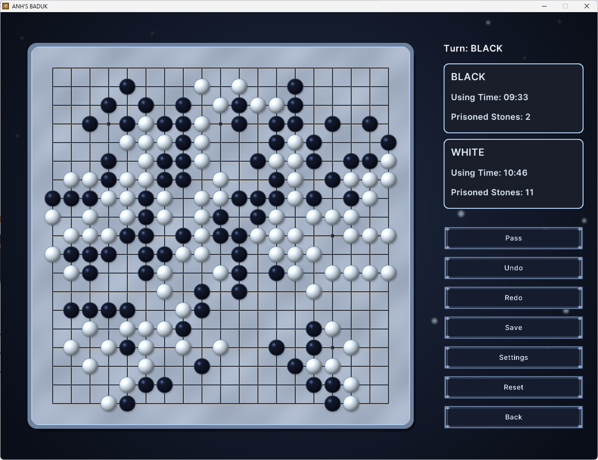

# CS160 Project: Go game

## Introduction
This is the C++ final project for the course **CS160 - Introduction to Computer Science**. 



The objective of this project is to recreate the traditional board game Go using C++ and the Raylib library, following the Japanese ruleset. The application aims to provide an intuitive and user-friendly interface for learning, practicing, and enjoying Go. Users can play against another player or a computer with three difficulty levels and choose from different board sizes. The game also allows users to undo and redo moves, save and load games, and customize settings.

## Features
The game currently supports two modes:
- Player vs. Player
- Player vs. Computer with three difficulty levels: Easy, Medium, and Hard

Notable features include:
- Adjustable board sizes: 9×9, 13×13, and 19×19
- Undoing and redoing moves
- Saving and loading games
- Settings
- Autosave current settings
- and many more!

## Dependencies

### Applications
- C++ 17 (GNU GCC 14.2.0)
- GNU Make
- [Raylib](https://github.com/raysan5/raylib)
- [JSON for Modern C++](https://github.com/nlohmann/json) 

## Building

1. Ensure GNU Make and raylib are installed on your platform before building. The Makefile is included in this repository, and the Windows raylib library is bundled.

2. Clone the repository to your machine
```sh
git clone https://github.com/shidou26/cs160-go-game.git
cd cs160-go-game
```

3. Build and run the game
```sh
make
mingw32-make //if GNU Make is installed as `mingw32-make` on Windows
```

The Makefile creates `Game.exe` on Windows or `Game` on macOS/Linux in the project root and launches it automatically. To run it again, execute `.\Game.exe` in Windows PowerShell or `./Game` on macOS/Linux from the project root.

## Demo

## Credit
- [Raylib](https://github.com/raysan5/raylib)
- [JSON for Modern C++](https://github.com/nlohmann/json)

Some music and imagery displayed in this game are not made or owned by us. All rights are reserved to their respective owners and no copyright infringement is intended.
